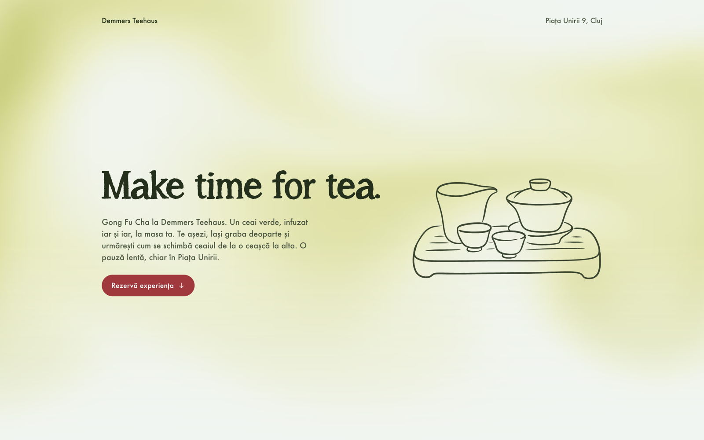
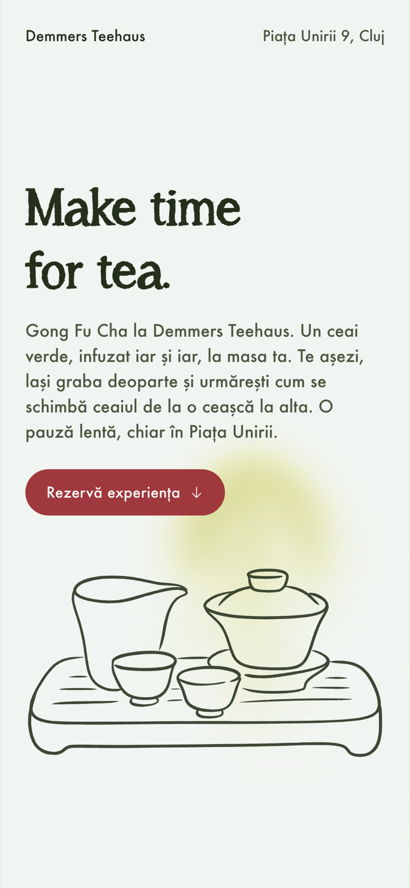
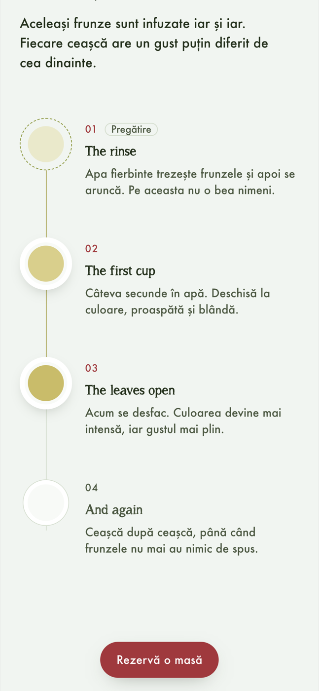

# Gong Fu Cha at Tea House

A dynamic QR code and a one-page booking site for a Gong Fu Cha tea session at a tea house in Cluj-Napoca.

QR stickers are spread around the city and inside the tea house. A passerby scans one, lands on the page, learns what Gong Fu Cha is and books a table without leaving the site.

> Work in progress. Copy, photos and the final booking account are still being finalised with the client.



<p>
  
  
</p>

## What is interesting here

- **Water you can stir.** The hero background is a small stable-fluids simulation (advection, diffusion and a pressure projection on a coarse grid) drawn to a canvas. Moving the cursor or a finger pours "tea" into the water. It pauses when the hero is off screen or the tab is hidden, and shows a still image under `prefers-reduced-motion`.
- **A QR code that never has to be reprinted.** The sticker encodes only `https://<domain>/qr`. That path is a 302 redirect in `site/_redirects`, with UTM parameters, so the destination can change at any time while the printed stickers stay the same.
- **Booking inside the page.** A Cal.com inline embed handles the calendar: 3 seats per slot (one per table), bookings close one hour before a session. A skeleton shows while it loads, a fallback link appears if it never does, and a custom confirmation replaces Cal.com's own screen.
- **The session as a sequence.** The steps of a session (rinse, first cup, the leaves open, again) sit on a thin thread. Each cup fills and comes forward as it reaches the reading line, and the rinse is marked as preparation because nobody drinks it. Everything stays readable without scrolling effects.
- **Mobile first.** 100% of the traffic comes from QR scans, so the phone layout is the real one. A small booking pill appears once the hero button scrolls away and hides near the calendar. Buttons never wrap; on very narrow screens they shrink instead.

## How I built it with AI

I built this project end to end with [Claude Code](https://claude.com/claude-code), Anthropic's coding agent, working as the person who directs, decides and reviews. The interesting part is not that an AI wrote code. It is how I set the agent up so that the output stayed on brief, stayed safe for a real client, and was checked before I accepted it.

### Context as a first-class input

- **A project memory file.** Before any code, I wrote a `CLAUDE.md` with the decisions that must never drift: the chosen package and price, hosting, booking provider, who owns which account, the 1 hour booking notice, the 3 tables, and hard rules such as "nothing goes on my personal accounts" and "the QR is not printed until it is tested on paper on two phones". The agent reads it at the start of every session. It is kept out of this repo because it contains client details.
- **A running context log.** A separate file records the client conversation, what was promised and what is still unknown. When the agent did not know something (the tea, the price, the session length), it marked it as a placeholder instead of inventing it.
- **Source material as a suggestion, not a spec.** The client sent a tone of voice document written for a different market. I had the agent summarise it and explicitly treat it as guidance, keeping out facts that belonged to another shop.

### Skills and design guardrails

- **Design skills.** I used two skills (reusable instruction packs for the agent): one for landing page structure and conversion copy, with a strict visual system (type scale, spacing tokens, motion curves, no gradients behind text), and one for design direction that makes the agent propose distinct visual worlds before building. I picked one of three directions, "steeping water", and the agent wrote a direction contract that every later change was checked against.
- **An automated design detector.** A hook ran after UI edits and flagged generic patterns (gradient text, a cream "default" palette, glow effects). The agent had to fix them, not argue with them.

### Verification loop

The agent did not stop at "the code looks right". After each change it opened the page in a real browser and checked it at 320, 375, 768, 1024 and 1440 px: horizontal overflow, whether buttons wrap, whether the font actually loaded, whether the steps light up in order while scrolling. A few things this caught:

- An accordion animation that "never finished", which turned out to be the browser pausing animations in a hidden tab. The fix was a timer fallback, not a rewrite.
- A headline font that rendered "ț" as a black fallback glyph. The agent remapped the glyph while subsetting the font, and when that still was not good enough, I decided the headlines stay in English.
- Two social icons stacked on top of each other because a more specific CSS rule was overriding the layout.

### Tooling the agent used

Beyond writing HTML, CSS and JavaScript, the agent drove real tools: `fontTools` to subset and remap the web font, `potrace` to vectorise the hand drawn illustration from its alpha channel into a 39 KB SVG, Playwright to take the screenshots above, and the GitHub CLI to publish this repository.

### Shipping safely

Publishing a client project publicly needs care. Before this repo went live, the agent separated private notes (pricing, client conversation, internal process, licensed font files) from the public code, moved them behind `.gitignore`, started a clean history so the old commits with those notes were never pushed, and scanned the staged files for prices, payment terms and credentials before the first push. Anything outward facing, such as creating the public repo or force pushing, waited for my explicit go-ahead.

### My role

I worked across three roles on this project, with the agent as the hands on the keyboard for most of the code.

- **Business analysis.** I turned what the client needed into concrete decisions: the choice of Cal.com over alternatives, how 3 tables of 2 seats map to 3 seats per slot, the 1 hour booking notice, how to stop one person from blocking every table, who owns which account, and what the client can change on her own. I answered her questions in writing and kept the scope, the open questions and the risks (domain expiry, font licensing, paper testing of the QR) in a written context file.
- **UI/UX design.** I set the direction and reviewed every iteration: the "steeping water" concept, the fonts, the lighter tea colour for visibility, the one-open-at-a-time FAQ, a smoother hero to content transition, a shorter footer, the photo layout, grouping the hero text with its button, the numbered steps with the rinse marked as preparation, and a mobile first booking flow, since every visitor arrives from a phone.
- **Code.** I reviewed and steered the implementation with clean structure in mind. Each feature (the fluid simulation, the steps, the FAQ, the booking pill, the tagline reveal, the calendar embed) is a self-contained module with its own private state, one responsibility each, and no shared globals between them. The code is deliberately plain JavaScript without classes or a framework: for one static page, encapsulation and single responsibility mattered more than class hierarchies.

The agent was fast at exploring and building; my job was to keep it pointed at the right problem and to say no.

## Stack

Plain HTML, CSS and JavaScript, no framework and no build step. Hosted on Cloudflare Pages.

- [Lenis](https://github.com/darkroomengineering/lenis) for smooth wheel scrolling on desktop
- [Cal.com](https://cal.com) inline embed for bookings
- [`qrcode`](https://github.com/soldair/node-qrcode) for generating the print-ready QR
- Phosphor-style icons, inline SVG

## Run it locally

```bash
npm install
npm run dev     # serves site/ on http://localhost:8080
npm run qr      # writes qr/gongfucha-qr.svg and .png from config.json
```

The headline font (A Song for Jennifer) is a licensed commercial font and is not included in this repository. Without it the headlines fall back to Futura or Jost.

## Structure

```
site/             everything that gets published
  index.html      the page: styles, markup and scripts in one file
  _redirects      the /qr redirect
  404.html
  assets/         illustration, favicon, fonts (not in the repo)
scripts/          QR generator
qr/               generated QR files (SVG for print, PNG for testing)
config.json       domain, QR path and UTM parameters
```

## Credits

Design and development by Andrei Zavorodnic (ZavoCreates) for a tea house in Cluj-Napoca.
